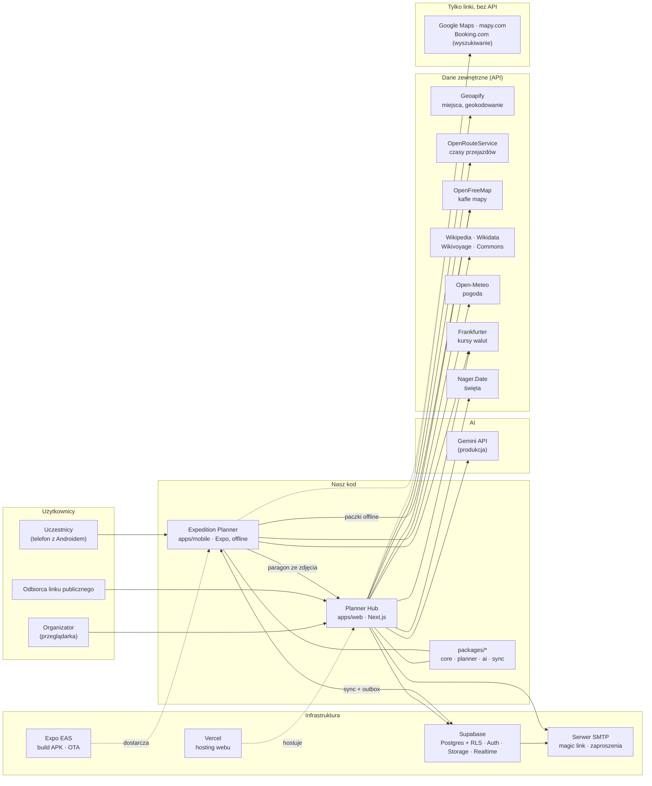
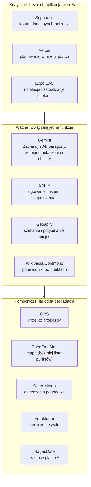

# Usługi, od których zależy projekt (stan na 7.11.2026)

Schemat pokazuje usługi, których kod faktycznie używa. Warunki, limity i werdykty każdej z nich są w [`USLUGI.md`](USLUGI.md); tu tylko to, kto z czego korzysta i co się stanie, gdy usługi zabraknie.

## 1. Architektura

Zasady widoczne na schemacie:

- **Telefon rozmawia tylko z Supabase** (i z darmowymi API bez klucza: kafle, pogoda, kursy). Wszystko, co wymaga klucza (Gemini, Geoapify, ORS), idzie przez serwer webu; klucze nigdy nie trafiają do APK ani przeglądarki.
- **Telefon działa bez sieci**: plan, przewodniki i mapa są w pamięci telefonu, zapisy czekają w outboxie.
- **Linki do Google Maps, mapy.com i Booking.com** to zwykłe adresy otwierane przez użytkownika. Kod nie pobiera z tych serwisów żadnych danych, bo ich warunki zabraniają zapisywania wyników (`USLUGI.md` §3, §5, §13).

Tylko przy pracy deweloperskiej (`tools/*`, poza schematem): `claude -p` na subskrypcji właściciela (import, plan AI), Nominatim i Photon (współrzędne fixture'ów), Docker z lokalnym Supabase.

## 2. Biznes: co zależy od czego

| Usługa | Funkcja dla użytkownika | Koszt dziś | Co przy komercjalizacji |
|---|---|---|---|
| Supabase | wszystko: konta, plan, wydatki, pliki | Free; Pro 25 USD/mies. przed realnym wyjazdem (Free pauzuje po 7 dniach) | bez zmian (Pro) |
| Vercel | Planner Hub w przeglądarce | darmowy plan | plan płatny dla użytku komercyjnego |
| Expo EAS | APK dla znajomych, aktualizacje OTA | darmowy plan | bez zmian przy małej skali |
| Gemini | AI w produkcji | w EOG tylko płatne rozliczenie (Paid Services) | bez zmian, rośnie z ruchem |
| SMTP | magic link, e-mail z zaproszeniem | darmowy limit dostawcy | bez zmian |
| Geoapify | miejsca i geokodowanie | Free, 3000 kredytów/dzień | płatny plan przy ruchu |
| Wikipedia/Commons | przewodniki | darmowe | bez zmian (atrybucja CC BY-SA) |
| OpenRouteService | czasy przejazdów | Free, 2000 tras/dzień | do sprawdzenia |
| OpenFreeMap | mapa na webie i offline | darmowe | bez zmian; większe paczki offline → Protomaps |
| Open-Meteo | pogoda | darmowe, **tylko niekomercyjnie** | wymiana albo płatny plan |
| Frankfurter | kursy walut | darmowe, także komercyjnie | bez zmian |
| Nager.Date | święta | darmowe, **komercyjnie tylko ze sponsoringiem**; brak świąt islamskich | sponsoring albo inne źródło |

Założenie biznesowe (D1 w `SPECYFIKACJA.md`): projekt „ja + znajomi”, APK poza Google Play, bez przychodów. Zmiana tego założenia wymaga przejrzenia wierszy oznaczonych pogrubieniem i werdyktów „OK z warunkiem” w `USLUGI.md`.
